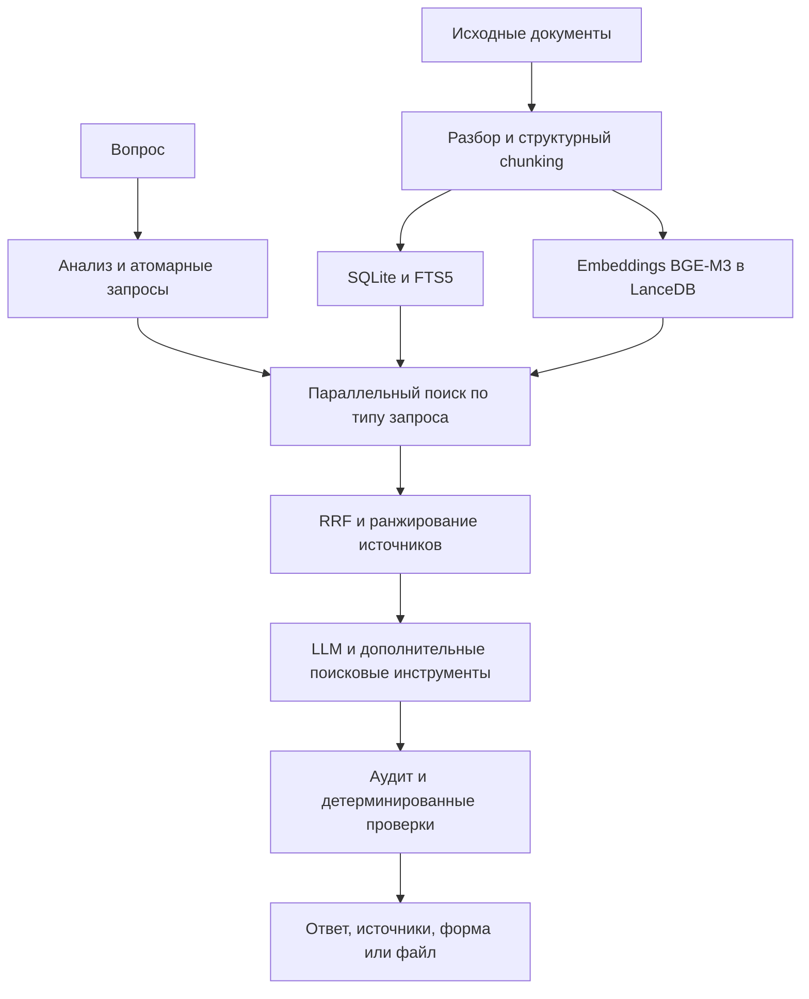

# RIVER: архитектура поиска и генерации

RIVER помогает отвечать на вопросы по российскому праву и налогам и готовить документы. Репозиторий описывает инженерные решения работающей системы. Исходный код закрыт.

## Как строится ответ

1. Исходные документы разбираются по структуре, таблицам и разделам. Вместе с чанками сохраняются тип, дата, редакция, статус и связи между документами.
2. Генерируется embeddings BGE-M3 в LanceDB и полнотекстовый индекс SQLite FTS5.
3. Анализатор разбивает составной вопрос на короткие поисковые релевантные запросы. Маршрутизатор выбирает подходящий уровень, чанки для конкретного факта, сводки кластеров документов и тем для обзорного вопроса.
4. Плотный и полнотекстовый поиск выполняются параллельно. Результаты объединяются по рангам с помощью RRF, затем учитываются тип и актуальность источника.
5. LLM получает пронумерованные источники и при необходимости запрашивает дополнительные фрагменты. После генерации отдельные проверки сверяют числа, ссылки и файлы.

На 31 октября 2026 года в рабочем индексе было **около 700 000 разобранных документов** и **2 438 760 чанков**.

## Важные решения

- Составной вопрос разбивается на поисковые единицы, чтобы отдельные факты не терялись внутри одного большого embedding.
- Cross encoder reranker исключён из основного маршрута после локальных замеров, потому что в части случаев он ухудшал размещение важных фактов и увеличивал задержку на CPU.
- Вложения идут отдельным маршрутом. Анализатор видит сжатый контекст вложения, а генератор получает содержимое, нужное для ответа. Это сеижает риск влияния текста файла на поиск.

В production LLM-вызовы идут через Yandex AI Studio. Backend написан на Python/FastAPI, frontend на JavaScript. Сервис работает через nginx. Также есть публичный веб поиск.

