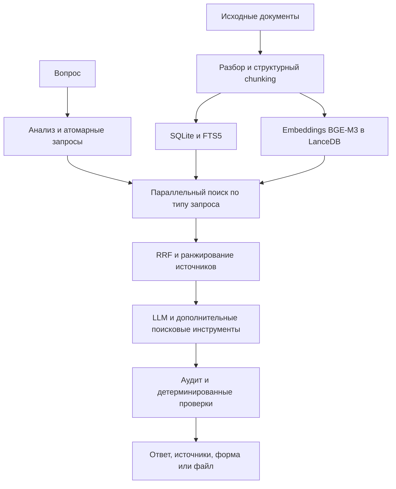

# RIVER: архитектура поиска и генерации

RIVER помогает отвечать на вопросы по российскому праву и налогам и готовить документы. Этот репозиторий описывает инженерные решения работающей системы. Исходный код, корпус документов, пользовательские данные и конфигурация сервера закрыты. Здесь нет запускаемой версии продукта.

## Как строится ответ

1. Исходные документы разбираются по структуре, таблицам и разделам. Вместе с чанками сохраняются тип, дата, редакция, статус и связи между документами.
2. Отдельные задачи индексации создают embeddings BGE-M3 в LanceDB и полнотекстовый индекс SQLite FTS5.
3. Анализатор разбивает составной вопрос на короткие поисковые запросы. Маршрутизатор выбирает подходящий уровень: чанки для конкретного факта, сводки глав и тем для обзорного вопроса.
4. Плотный и полнотекстовый поиск выполняются параллельно. Результаты объединяются по рангам с помощью RRF; затем учитываются тип и актуальность источника.
5. LLM получает пронумерованные источники и при необходимости запрашивает дополнительные фрагменты. После генерации отдельные проверки сверяют ответ, числа, ссылки и содержимое файлов.

На 31 октября 2026 года в рабочем индексе было **602 824 успешно разобранных документа** и **2 438 760 чанков**. Число чанков в SQLite и LanceDB совпало. Это размер закрытого корпуса, а не показатель точности ответов или скорости поиска.

## Важные решения

- Составной вопрос разбивается на поисковые единицы, чтобы отдельные факты не терялись внутри одного длинного embedding.
- Обзорные индексы не подключаются к каждому вопросу: на конкретных запросах они вытесняли нужные чанки из контекста.
- Cross-encoder reranker исключён из основного маршрута после локальных замеров: на проверенных случаях он ухудшал размещение важных фактов и увеличивал задержку на CPU.
- Вложения идут отдельным маршрутом. Анализатор видит ограниченный контекст вложения, а генератор получает содержимое, нужное для ответа. Это снижает риск влияния текста файла на поиск, но не устраняет prompt injection полностью.
- Готовый DOCX или XLSX проверяется как отдельный результат. Правильный текст в чате не доказывает правильность скачиваемого файла.

В production LLM-вызовы идут через Yandex AI Studio. Backend написан на Python/FastAPI, frontend на JavaScript. Сервис работает через nginx и systemd. Публичный веб-поиск включается отдельно и ограничен серверными правилами.

Подробнее: [путь запроса и данные](architecture.md), [проверка качества и релизов](quality.md).
